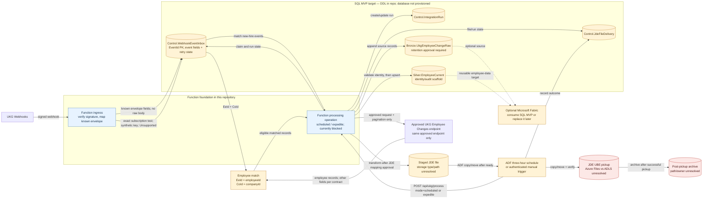

# UKG to JDE new-hire integration — preliminary architecture

**Status:** review draft. The repository contains Python Azure Functions routes, a parameterized SQL repository, and T-SQL design artifacts. The SQL database has not been provisioned. Processing remains blocked until the approved Employee Changes contract and JDE mapping are supplied.

## Flow and operational behavior

1. UKG sends a signed event to the Function ingress. The Function verifies the signature and stores `EventId` (`BIGINT`), `EventTime` (`DATETIMEOFFSET(3)`), `EventType` (`NVARCHAR(100)`), `Operation` (`NVARCHAR(50)`), `Payload.EeId` (`NVARCHAR(50)`), and `Payload.CoId` (`NVARCHAR(20)`) in the SQL inbox. It omits `Payload.PersonId`, `Payload.IntegrationRecordId`, `Tenant`, and the complete request body. `EventId` is the primary key and duplicate-delivery key for this single-tenant integration.
   UKG's exact subscription-test JSON object is recognized after HMAC verification and JSON parsing, before employee-event parsing. It is recorded in this inbox with a fresh synthetic ID from a reserved negative `BIGINT` range, `EventType='SubscriptionTestConnection'`, `Operation='Test'`, current UTC event time, NULL employee keys/run ID, and `ProcessingStatus='Unsupported'`. The static message and request body are not stored. A key collision retries with a newly generated key; this assumes UKG EventIds are nonnegative. Pending consumers select only `Received`, `Pending`, and `Failed`, so test rows are never claimed. UKG receives HTTP 200 only after the insert commits.
2. ADF will invoke the processing operation every three hours or through a separately authenticated manual expedite path. The scheduled request is expected to use the approved parameterized Employee Changes call and the three-hour window. Expedite is expected to paginate the same approved endpoint fully. Testing has observed fresher results from full pagination; this difference requires UKG validation and is not treated as a contract.
3. Match webhook `Payload.EeId` to endpoint `employeeId` and `Payload.CoId` to `companyId`, using both values together where appropriate. `EventId` deduplicates the webhook and is not used for employee matching. Keep webhook event metadata in the inbox and returned employee records in separate Bronze/Silver layers. No other endpoint response fields are confirmed, so do not model them yet.
4. After the JDE mapping is approved, the Function writes a completed file to staging. ADF moves/copies it to the UBE pickup, verifies delivery, updates SQL delivery tracking, and archives the staged artifact according to an agreed policy.

## Retry, idempotency, and archive

- Webhook delivery retries are safe through the inbox primary key on `EventId`; duplicate inserts leave the existing processing status, counters, timestamps, and run association unchanged.
- ADF/Function processing should claim pending inbox rows in a transaction using skip-locked semantics. Attempts and safe failure summaries remain on the event/run records. API pagination and transient retry behavior require the approved endpoint contract.
- Unique delivery and staged paths plus a claim transition prevent duplicate SQL tracking and overlapping workers. Exactly-once physical file handoff also requires a deterministic pickup filename and verified transfer behavior; SQL and a file copy cannot share one transaction.
- Proposed path sequence: `staging/jde/new-hire/yyyy/MM/dd/{run_id}/...` → approved UBE pickup location → agreed archive. Staging and pickup storage types, atomic publish/ready-marker mechanism, and archive path need confirmation. Azure Files is one candidate for UBE pickup; ADLS is a staging candidate.

## Implementation status and boundaries

- **In repository now:** Python v2 Function ingress and processing routes, signature-verification integration, SQL persistence code for known inbox fields and run state, and the `(EeId, CoId)` to `(employeeId, companyId)` matching helper. Processing remains blocked on the rest of the approved API contract and JDE file mapping.
- **SQL MVP:** Azure SQL Database is a working assumption because no database platform is configured in the repository. The scripts are T-SQL design artifacts only and have not been executed.
- **Later ADF work:** invoke processing, route on `ready`/`blocked`/`failed`, transfer staged files, and update delivery outcomes. No ADF pipeline is included here.
- **Fabric option:** Fabric may consume the SQL Bronze/Silver layers, or replace SQL after a separate decision about operational control transactions, latency, and ownership. It is not part of this MVP.
